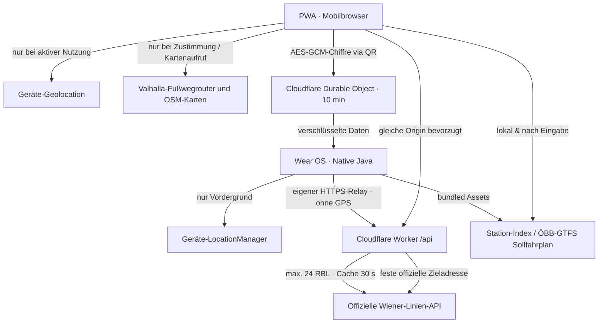

## PWA 0.4.3 · Favoriten auf schmalen Displays · 09.11.2026

Lange Richtungsnamen in Verbindungsfavoriten erhalten eine eigene umbrechende Zeile. Linie/Stern und große erste/zweite Abfahrt stehen darüber, Erreichbarkeit darunter. Explizit begrenzte Grid-Spalten verhindern, dass Nachladen die Seite seitlich verbreitert. Hauptnavigation und Kopf bleiben bei kleinen Breiten lesbar. 28-px-Hauptzeiten und 44-px-Stern-Tippfläche bleiben erhalten; keine überlappenden negativen Sternränder.

PWA-Version/Offline-Shell 0.4.3. Favoriten-, Linien-, QR- und Datenformate unverändert. Native Wear 0.4.2 / Code 17 und dessen signierte APK bleiben unverändert. 231 bestehende Web-/Serverprüfungen erfolgreich; Öffentliche Browserabnahme: echte PWA bei 320/360/420 px Rahmenbreite (305/345/405 px nutzbar mit Desktop-Scrollbar), Hell und Dunkel. Nach Live-Nachladen und wiederholtem Countdown-Render bleibt scrollWidth gleich clientWidth; keine sichtbaren Elemente außerhalb des Viewports. Geprüft mit langer 29B-Richtung sowie leerer Abfahrtszeile. Stern bleibt tatsächlich 44 × 44 px. Temporäre Prüfseite danach entfernt.

## Reisevarianten und Etappenfokus · 0.4.1 / 0.4.1
Live-Abnahme: Bei 29B nach Großfeldsiedlung nennt der Planer das Ziel ohne U-Bahn-Suffix, der Monitor mit „U (über Leopoldau S U)“. PWA und Uhr vergleichen vollständige Zielnamen nach Entfernen reiner S/U-Suffixe. Zusätzliche Monitor-via-Angaben sind bei allgemeinem Planerziel erlaubt; eine ausdrücklich geplante via-Angabe muss übereinstimmen. Keine Teilwort-/Gegenrichtungszuordnung. Gespeicherte Variantenidentitäten bleiben davon getrennt. Zwei Web- und ein nativer Regressionsfall sichern echte Schreibweisen, zweite Etappe und verspätete Detaildaten ab.

journey-variants.mjs bildet einen datumsunabhängigen Schlüssel aus Modus, Linie, Ein-/Ausstieg und Richtung. Mehrere Abfahrten desselben Wegs sind ein Muster; echte andere Fahrtwege bleiben vollständig erhalten. Gemeinsamer Ride-Prefix bestimmt die Anzeigestelle der Alternativen. UI wechselt komplette ursprünglich gelieferte Itineraries; niemals Zeiten/Trip-Teile zweier Reisen manuell zusammensetzen. Favorit enthält einen Basisweg plus maximal 15 alternative legs-Templates. GPS-Reduktion und Timestrip gelten rekursiv für alle. Import führt Familien über gemeinsame Wege und identische Endpunkte zusammen, bewahrt ID/Name/Reihenfolge; zu viele Varianten bleiben ein Fehler vor jedem Schreibschritt.

Ausgewählte Etappe/focusedLeg bestimmt die nächsten Abfahrtsziele, ausgewählte Verbindung in der Stations-Unterseite nutzt ihren eigenen Station/Linie/Modus/Richtung-Scope. Browser-History merkt Variante und Verbindungsziel flüchtig. Alte Requestrevisionen/Antworten verwerfen; gemeinsames 24/30-Budget unverändert. showSteps erneuert im Routinebetrieb nur LIVE-Slots, damit geöffnete Fußwegkarten und Leseposition nicht verloren gehen. Karte je Walk-Leg lazy/on-demand ohne Planung, mit exakter Geometrie oder erklärtem Fallback.

QR capability text kann bekannte JSON-Listen enthalten und liest alte bare journey-favorites-v1 weiter. Keine neue Migration neben 0004. Neue Uhr meldet Alternativenfähigkeit, alte Uhr bekommt sichtbar angekündigte Reduktion auf Basisweg. WebCrypto/Java-v2-Pakete behalten Schlüssel-/TTL-Vertrag. Native Route-Options zeigt Verzweigungsstationen und aktuelle Zeiten; Variantenwahl setzt journeyBoarding auf die neue Verzweigung und ersetzt RequestScope.

Signierte APKs bleiben bytegenau erhalten. Die aktuelle APK ist als Fallback eingebunden und wird beim Download unverändert in R2 gesichert. Frühere Releases werden aus R2 gestreamt; alle bekannten Dateinamen, Größen und Prüfsummen stehen im dauerhaft verfolgten site/native-releases.json. Import akzeptiert ausschließlich genau diese öffentlichen bereits signierten Dateien nach Größen-/SHA-Prüfung (maximal 8 MiB); keine beliebigen Uploads oder Überschreibungen. Neue Dateiversionen ergänzen das Manifest, alte Einträge bleiben. Keine Signierdaten in R2. So wächst der Worker nicht mit allen APK-Versionen.

## Routenkarte und Watch-Routen ab 0.3.3 / 0.4.0

journey-geometry dekodiert gebundene MOTIS-Polylines mit sechs Dezimalstellen; journey-map lädt ausschließlich lokales Leaflet und auf Aktion OSM-Kacheln. Provider-Geometrie bleibt flüchtig bzw. bei bewusst gespeicherten festen Wegen lokal begrenzt; dynamische GPS-Endabschnitte werden gestrichen. Im QR werden sämtliche Geometrie/Abschnittskoordinaten entfernt. Ortsdaten nur beim expliziten Suchen/Absenden; Match-Adapter unterscheidet ADDRESS/STOP und setzt Straße/Hausnummer/PLZ zusammen. Exakte offizielle at:49-IDs einschließlich parent Pat:49; keine Namens-/Radius-Zuordnung.

Station hat eigenen transienten Monitor-Scope und ignoriert globale Modusfilter für Alle Abfahrten. Revisionen verwerfen alte Requests bei jedem Scopewechsel, auch wenn die ausgewählte Reise bestehen bleibt. Browser-Back/Forward und Top bei Neueröffnung erhalten; alle Dienste pausieren bei hidden/pagehide. Such- und Kartenansicht verwalten Zustände unabhängig; keine zusätzliche Vollplanung durch Kartenansicht/Favoritöffnung.

Routen-Schlüssel bleibt foama.journeyFavorites.v1; natives JourneyStore speichert getrennt unter journeyFavorites. v2 ist nur das Transportformat, v1-Stationen bleiben unverändert. D1 capabilities ist eine feste bekannte Versionsfähigkeit, kein Freitext-/Nutzerprofil. Native Vorschau schreibt nichts, explizite Übernahme schreibt beide Favoritenarten mit einem SharedPreferences-Commit. Fehler/Limit vor Commit lassen beide Listen erhalten. Routenmonitor nutzt vorhandenen RequestScope, sichtbares Budget, Frische/Fehlerstatus und exakte Station/Linie/Modus/Richtung. Alte Reisezeiten werden niemals importiert oder als live wiederhergestellt.

Abrufkompatibilität: workerd unterstützt bei fetch nur redirect manual/follow. Der Reise-Relay nutzt manual, prüft 3xx als Fehler und folgt keinem Location-Header. Keine Browser-Cookies/Authentifizierungsheader werden weitergegeben.

## Reiseplanung und lokale Wege ab 0.2.0

journey.html/journey-page.mjs hält Suche, Auswahl und aktuelle Monitorwerte im Arbeitsspeicher. Nur ausdrückliches „Weg merken“ speichert das minimierte Linienweg-Template lokal; journey-favorites.mjs verwirft Zeiten, Trip-IDs und rohe Anbieterdaten, GPS-Start wird dynamisch. Öffnen eines Favoriten fragt keinen vollständigen Plan ab; separate Fußwegaktion fragt die Stationslage des ersten Einstiegs ab und schätzt Gehzeit mit Nutzertempo, Bahnsteigweg zusätzlich. Ergebnisse/gespeicherte Wege sind getrennt: letzterer behauptet weder aktuelle Fahrtdauer noch Anschluss.

Same-origin POST-Endpunkte in journey-service.mjs validieren Größe, Koordinaten, Zeitzone, Zeitfenster, Modi und Optionen, erlauben nur drei fest konfigurierte Transitous-Produktionspfade, begrenzen Antwortgröße/Timeout und normalisieren vor Auslieferung. Ein atomarer D1-Zähler pro Stunde/Art enthält keine Such-/Geräte-/IP-/GPS-Daten. Höchstens 700 Planung+Fußweg und 500 Geocode in aktueller plus 24 vorherigen Stunden; Retention höchstens 26 Buckets pro Art. Fehlt DB/Schema, fail closed. Migrationsappend 0003.

Aktuell sichtbare Reise: nächste zwei Einstiege innerhalb des gemeinsamen 24-RBL/30-s-Budgets; Abbruch bei Navigation/Hintergrund, frische exakt zugeordnete Linien-/Richtungsalternativen, keine unbewiesene Trip-Verknüpfung. Neuplanung/Geocode/Weg nur bei Aktion. Kein präziser Input in URL/History, Diagnose oder serverseitiger Speicherung. Vienna-Datum unabhängig von Gerätezeitzone; ungültige DST-Frühlingszeiten abweisen. MIT nur eigener Code; Transitous-/OSM- und Drittquellen getrennt.

Native Reiseplanung nach Nutzersteuerung zurückgestellt. Scroll-Revision in MainActivity verwirft alte post-Restores, neuer Bildschirm bleibt bis Layout auf Top, laufendes Re-Rendering bewahrt Leseposition. Browser-Verbindungsnavigation nutzt manual scrollRestoration und prüft vor verzögertem Scrollen den tatsächlich geöffneten Zielzustand.

## PWA 0.1.29 · Kopf-Icons und vorbereitete Reiseplanung

Kopfaktionen verwenden gemeinsame 44-px-Ziele und gleich große SVGs. Standortkarte verwendet weiterhin den gewählten Suchradius für den initialen Ausschnitt, wie nach Nutzerklärung bestätigt.

journey-planning.mjs ist nicht in der öffentlichen UI eingebunden und startet keine Anfrage beim Import. Explizit konfigurierbarer MOTIS-v6-Adapter, strikte Abfragefelder, Zeitzone, Gehgeschwindigkeit und zusätzliche Umstiegsreserve. Normalisiertes Reisemodell mit chronologischen Abschnitten; Ausfälle/unbrauchbare Alternativen verwerfen, Echtzeit nur bei Anbieterkennzeichnung. IFOPT at:49 exakt auf bekannte DIVA, keine Namens-/Entfernungszuordnung. Monitoralternativen erfordern frische Daten, Station/Richtung/Modus und früheste erreichbare Abfahrt; kein Beweis derselben Fahrt. Anfrageabbruch bei Ersetzen/Abbruch, 20-s-Timeout, begrenzte Antwortgröße, kein Cache-/Nutzerverlauf. Anbieterwahl/Lizenz vor UI-/Produktionsanbindung offen.

## PWA 0.1.28 · öffentliche App teilen

Updateprüfung über update.json ohne Browsercache, beim Start und alle fünf Minuten ausschließlich sichtbar; Hintergrund bricht die Anfrage ab. Wartende Worker zeigen ebenfalls den Hinweis. Neue Worker überspringen Warten nicht mehr automatisch: Jetzt aktualisieren aktiviert den fertig installierten Worker per FOAMA_ACTIVATE_UPDATE und lädt erst nach Controllerwechsel neu. Ohne Service Worker normaler Reload, Fehler/Offline bleiben wiederholbar. Favoriten und Einstellungen werden nicht gelöscht. Kein Update eines anderen Tabs ohne dessen Nutzeraktion erzwingen.

app-share.mjs bindet ausschließlich die vorhandene Header-Aktion und den neuen Fallbackdialog. Web Share wird direkt aus der Nutzeraktion aufgerufen; laufende Auswahl verhindert doppelte Aufrufe. AbortError endet ohne Fallback; nicht unterstützte/gesperrte native Freigabe öffnet Dialog. Clipboard erst nach ausdrücklichem Klick, bei Fehler öffentlicher Link manuell markiert. WhatsApp-Anker erst nach bewusstem Klick extern, rel=noopener noreferrer. APP_INVITATION verwendet die feste öffentliche Root-URL, niemals location.href oder gespeicherte Nutzerdaten. Kein Timer, keine API-Abfrage, kein Tracking oder Speicherkanal. Bestehende Dialogpause und Detail-Aktualisierung erhalten; Modul mit/ohne Versionsquery offline cachen.

## PWA 0.1.27 / Wear 0.3.6 · Favoritentexte

Reine Anzeigetextänderung. PWA renderFavoriteTools zeigt nur bei Entfernungssortierung ohne Position eine kurze Fallback-Erklärung; bei vorhandener Position kein Kontextabsatz/Leerraum. distance/manual sowie sortDistance und alle Datenschlüssel bleiben unverändert. A-nach-B-Reiseplanung ist unter [journey-planning.md](journey-planning.md) vorgemerkt; keine neue Route, kein neuer Dienst und keine Schlüssel aktiviert.

## PWA 0.1.26 / Wear 0.3.5 · Stationslinien

scripts/wl_gtfs_catalog.py verbindet GTFS-IFOPT-Stationsnummern exakt mit DIVA 602xxxxx; kein räumlicher/namebasierter Nachbar-Join. calendar und calendar_dates bestimmen die belegte Servicewoche; stop_times ohne Ein- und Ausstieg zählen nicht. OGD-Codierung für Rufbus/Badner Bahn gezielt normalisiert. prepare_stops.py verlangt offizielles GTFS-ZIP, hält candidateLines separat und erzeugt Quelle/Zeitraum/SHA-256. Aktueller Katalog ist ein datierter Offline-Snapshot, keine ständige serverseitige GTFS-Neuberechnung.

site/runtime.mjs stellt dem Monitor eine einmal dekodierte UTF-8-Katalogkopie bereit. line-registry.mjs verarbeitet ausschließlich die feste offizielle Monitorquelle für tatsächlich angeforderte RBL. D1-upserts verwenden MIN(firstSeen)/MAX(lastSeen), Checks aggregiert pro Station/Wiener Datum/Sechs-Stunden-Bereich; keine einzelne Anfrage-/Nutzerhistorie. Raw-Monitorcache erhält Erzeugungszeit; Cachehit liest die gemeinsame Evidenz, erneuert weder Bestätigungen noch Vollprüfungen. Veraltete/beschädigte Betreiberzeit wird nicht als frischer Beleg behandelt. D1-Fehler lässt Abfahrten erfolgreich und meldet Evidenz unavailable. Migration gehört ausschließlich zum Deploypfad.

foamaLines enthält für betroffene Stationen lines/lastSeen/confirmed und suppressed. PWA line-evidence.mjs validiert/whitelistet den lokalen Spiegel, neue Stationsbeobachtungen erneuern nur jeweils gemeldete Linien. Neuere tatsächliche Beobachtung überstimmt eine ältere zwischengespeicherte Unterdrückung. Native Repo übernimmt dieselbe Antwort im vorhandenen RequestScope.commit, hält die öffentliche Offlinekopie begrenzt und ersetzt Routenlisten atomar; laufende UI-Iteratoren werden nicht mutiert. Favoriten werden nie automatisch entfernt. Vollständige Prüfungen hängen vom abgefragten RBL-Umfang ab, nicht vom Namen der geöffneten Seite.

## PWA 0.1.25 · Stationslinien-Layout

station-services verwendet eine einspaltige Grid-Struktur: volle Linienauswahl, Verkehrsmittel, danach ggf. Erklärung gedimmter Linien. Innerer Badge-Flex hat keine zusätzlichen Zeilen-/Spaltengaps; die unabhängigen 44-px-Tippflächen erzeugen bereits Abstand, 32-px-Badgehöhe reduziert leere Zwischenräume. Gilt ausschließlich für Stationskarten, Meldungs-/Kartenbadges behalten ihre bisherigen Größen. Keine neue Datenlogik, Speicherung oder Requests.

## PWA 0.1.24 / Wear 0.3.4 · Verbindungsfokus und gemeinsame Stationsdarstellung

connection-detail.mjs trennt Stations-/Routen-/Richtungsselektion, frische Bestätigung, relevante RBL und History-Navigation. History-State enthält ausschließlich validierte flüchtige Auswahl; kein neuer Persistenzschlüssel oder Standort im URL. Eigene section statt dialog: Verbindung bleibt eine aktive Hauptansicht. Ausgeblendete Übersicht bleibt für Rückkehr erhalten; Darstellung und Tastaturfokus werden nach Navigation wiederhergestellt. Sibling-Overlay-Knöpfe öffnen Zeilen, separate Sterne behalten ihre unabhängige Aktion.

refreshDepartures verwendet im Fokus nur gespeicherte Verbindungs-IDs. Bekannte tatsächliche Route/Richtung vor Route, dann Stationsbahnsteige des Modus, schließlich dieselbe Station, maximal 24. Die Betreiber-API liefert je Bahnsteig ggf. auch andere Linien; dafür entsteht kein weiterer Request. AbortController plus Ansichtsrevision verwerfen überholte Antworten vor Cache-/Lern-/Warnungsänderungen und ohne künstlichen Backoff. Globaler letzter Versuch bleibt auch nach Abbruch maßgeblich. Neuer Fokus wartet auf laufenden Abschluss und verbleibende 30-s-/Retry-Sperre. Routingziele im Fokus ebenfalls nur gewählte Station. Parser bevorzugt vehicle.name/towards/type mit Monitor-Fallback.

Native MainActivity verwendet stationPanel/stationHeading für Nähe und Favoriten, dieselben connectionCard-Zeilen für beide Home-Ansichten. Nur der Inhaltsfilter und explizite Favoritenaktionen unterscheiden sich. badge erhält aktuelle Bestätigung aus Repo.fresh; keine Katalog-/Datenlücke als bestätigten Betriebsschluss ausgeben. Native Detail-Polling weiterhin stationsbezogen, vorhandenes Lifecycle-/Fair-Use-Verhalten unverändert.

## Wear 0.3.3 · Menünavigation und globale Filter

MainActivity trennt push, push-delivery, push-filters und push-info; asynchrone WatchPush-Statusänderungen aktualisieren die jeweilige sichtbare Unterseite. Einstellungen ändern denselben lokalen Zustand, ohne Freigabe/Opt-in auszulösen. Gemeinsamer Back-Pfad führt Kinder zu push, danach zur ersten Menüebene. TransportShortcut gehört ausschließlich als erster Eintrag in den Home-Inhalt; Stationen/Favoritenkarten sind nachfolgende Geschwister und tragen eigene Stations-Tags. Damit zählt der globale Filter nicht als sichtbare Station im Request-Budget. TransportIcon besitzt definierte intrinsische Maße; kleine Runddisplays rücken Minuten innerhalb ihrer Spalte vom äußeren Kreisrand weg.

wear.html/wear.css bleiben statische Assets derselben öffentlichen Site. Vier Featuretexte und tatsächliche native Beispielrenderings; Installation/Versiondetails über native HTML-details. Kein neuer Tracker, Account oder UI-API-Request. PWA selbst bleibt 0.1.23.

## Wear 0.3.2 · begrenztes Keep-awake für QR-Transfer

MainActivity besitzt FLAG_KEEP_SCREEN_ON nur bei aktiver, sichtbarer und nicht geschlossener TransferManager-Sitzung. Ein eigener Handler-Timeout läuft unabhängig vom Polling (auch bei laufender Anfrage oder offener Importvorschau). Die Obergrenze wird mit elapsedRealtime ab Öffnen berechnet und durch das Serverablaufdatum ggf. verkürzt. finishTransfer beendet RequestScope/Future, Timer, Schlüssel, QR und Vorschau, belässt die Abschlussmeldung auf der Seite und gibt das Display frei. closeTransfer räumt bei Navigation/Pause zusätzlich die Sitzung auf. transferValid verwirft auch Antworten geschlossener Manager; Bestätigung nach Ablauf importiert nichts. Normale Standort-/Monitor-Lebenszyklen bleiben erhalten.

## PWA 0.1.23 / Wear 0.3.1 · Meldungspriorität

traffic-info.mjs bewertet Equipment-Kategorien und gültige Zeitgrenzen anhand des aktuellen Zeitpunkts. warningsForTargets zählt ausschließlich bereits begonnene, nicht erledigte Betriebsereignisse. stationNoticeSections rendert getrennte gelbe Warnungen mit Linienbadges und neutrale Zusatzhinweise mit eigenem Disclosure-Schlüssel; reine Ansicht, keine Datenmigration oder neue Requests. Ein gültiger Beginn überschreibt ein altes planned-Flag beim Anzeigen. pushNoticeMatches nutzt dieselbe zeitliche Aktivitätsregel; die vorhandene Equipment-Opt-in bleibt erhalten. Repo.hasCurrentServiceNotice wertet native Monitorreferenzen gegen Kategorien und Zeiträume aus; unbekannte Referenzen werden vorsichtig weiter markiert.

## PWA 0.1.22 / Wear 0.3.0 · Sichtbare Stationen und gemeinsame Favoritenkarten · 08.11.2026

Favoriten derselben Station erscheinen in einer gemeinsamen Karte, auch wenn nur einzelne Linien/Richtungen gespeichert sind. Der Stationsname ist immer die Hauptüberschrift; Richtungen stehen darunter. PWA: einzelner Stern entfernt nur die gespeicherte Verbindung, ein exklusives Stationsmenü verschiebt/entfernt die gesamte Karte. Entfernungssortierung gruppiert nur die Ansicht; gespeicherte Reihenfolge, JSON, QR und lokale Datenschlüssel bleiben erhalten. Watch: gleiche Stationsgruppierung, Verbindungen weiterhin einzeln über das Detail entfernbar. Ganze Station plus einzelne Verbindungen erzeugen keine doppelten geladenen Zeilen.

Warnmeldungen: betroffene Linien bleiben sowohl in der geschlossenen Warnmeldungen-Karte als auch im geschlossenen Stationshinweis als farbige Linienbadges sichtbar. Alle zusammengefassten Ereignisse tragen bei. Explizite Betreiber-Linienreferenzen haben Vorrang; bei fehlenden Referenzen werden nur eindeutige Linienlisten im Meldungstitel übernommen, keine beliebigen Zahlen aus Beschreibungstexten. Leere Warnbereiche bleiben verborgen; Relevanz, Deduplizierung und Kennzeichnung älterer Daten erhalten.

Abrufpriorität: tatsächlich sichtbare Stationen verbrauchen zuerst das bestehende 24-RBL-Budget, erst danach außerhalb des Bildschirms liegende Stationen. PWA: sichtbar und aufgeklappt vor sichtbar geschlossen. Innerhalb derselben Sichtbarkeitsstufe bestätigte U-Bahn vor Tram vor Bus; bei Überlauf begrenzte Rotation. Scrollen verursacht keine zusätzlichen Requests innerhalb der 30-Sekunden-Sperre. Pause beendet normales Monitor-Polling und GPS. Offene PWA-Dialoge sowie native Unterseiten halten Monitor-Polling an. Josefstädter Straße U: Tram-RBL liegen numerisch vor den U6-RBL 4607/4622; die frühere Verteilung konnte U6 im ersten Budget verdrängen. Es gab dort keine PWA-Dreiergrenze. Öffentlicher API-Abruf mit allen acht Bahnsteigen lieferte zwei U6-Richtungen und drei Tram-Richtungen; Katalog-Badges bedeuten nicht, dass jede historische Linie aktuell fährt.

Direkter Watch-Push ist im nativen Code vorbereitet: ausdrücklicher Opt-in, Android-Freigabe, Favoriten/alle Linien, Nachtruhe, Aufzüge, Test/Abmeldung und begrenztes lokales Hinweisarchiv. FCM plus Firebase Installations nur nach Opt-in; keine Analytics/Auth/Firestore/Hosting/Functions. Kein Hintergrund-GPS oder Abfahrts-Polling. Google verarbeitet Zustellkennung und Nachrichtentext, unser bestehender Dienst verschlüsselte Minimalfilter. Firebase-Projekt/Serverfreigabe und physische Zustellung sind noch nicht verbunden/geprüft. PWA verwendet weiterhin standardmäßigen Web Push. PUSH_SCHEDULER_ENABLED=false bleibt bis zum nachgewiesenen Hintergrundbetrieb erhalten; ein begrenztes Site-Werkzeug prüft während der Einrichtung ausschließlich die offizielle Quelle. [Betrieb und Konfiguration](push-notifications.md).

Wear 0.3.0 / Code 7, Paket at.andrew.foamawien und ursprüngliches Zertifikat. Update: Mehr → App & Updates → Auf Update prüfen; nicht deinstallieren. 139 Node-, 77 native Android- und drei Python-Prüfungen; native Beispielrenderings. Browser bestätigt gemeinsame Karten und Bewegung ganzer Stationsgruppen; weiterer Vorschauzugriff durch interne URL-Policy blockiert, kein behaupteter kompletter mobiler Browser-Rundlauf. Physische Watch-/Push-Abnahme separat. ÖBB/S-Bahn-Datenquelle weiterhin offen.

## Historische Releases und ergänzende Dokumentation

## PWA 0.1.21 / Wear 0.2.5 · Verkehrsmittel und Karlsplatz · 08.11.2026

U-Bahn vor Tram vor Bus: nahe Stationskarten auf beiden Geräten nach dem besten eingeschalteten, belegten Verkehrsmittel, innerhalb derselben Gruppe nach Entfernung. Die PWA begrenzt die Liste erst nach dieser Sortierung und erhält die Priorität beim Neuzeichnen mit Gehentfernungen. Gespeicherte Favoriten behalten ihre manuelle Reihenfolge.

Watch: bisherige harte Vorschaugrenze von drei Linien/Richtungen in Nähe und ganzen Stationsfavoriten entfernt. Alle geladenen passenden Verbindungen erscheinen; U-Bahn-Gruppen stehen vor Tram und Bus, danach nächste Abfahrt. Der erste API-Batch priorisiert in Nähe bestätigte eingeschaltete U-Bahn-Bahnsteige; höchstens 24 RBL, 16 priorisierte plus acht rotierende bei Überlauf. Favoriten behalten die Stationspriorität, innerhalb einer Station werden höher priorisierte Bahnsteige zuerst abgefragt.

Aktive Verkehrsmittel erscheinen als lokale Vektorsymbole direkt im Hauptbild. In Nähe mit dem ersten Stationskopf und der geschätzten Gehzeit kombiniert, in Favoriten als kompakte Zeile. Tippen öffnet sofort Verkehrsmittel; Zurück, Wischen und System-Back kehren zur vorherigen Hauptansicht zurück. Alle ausgeschaltet: klarer Hinweis und weiterhin erreichbar. Volle 48-dp-Tippfläche, keine zusätzliche Hintergrundarbeit. Menüpfad Mehr → Standort & Nähe → Verkehrsmittel bleibt erhalten.

Wear 0.2.5 / Code 6, Paket und ursprünglicher Signaturschlüssel bleiben erhalten. Update über Mehr → App & Updates → Auf Update prüfen. Nicht deinstallieren. Native Abnahme mit synthetischen Karlsplatz-Testverbindungen; physische Uhr-/Live-Karlsplatz-Abnahme separat erforderlich. ÖBB/S-Bahn-Anbindung bleibt offen; Filter allein bedeutet keine Datenquelle.

Push für Telefon und eigenständige Watch ist weiterhin ein eigener offener Arbeitsstrang: PWA-Infrastruktur vorhanden, Aktivierung wegen fehlendem verlässlichem Server-Timer gesperrt. Native FCM-Konfiguration/Anbindung noch offen. Firebase-Verbindung zur weiteren Einrichtung angeboten; keine aktive Watch-Push-Zustellung behaupten.

Push-Gate derzeit aus: Plattform-Hintergrundauftrag fehlgeschlagen/pausiert. Der vorbereitete Docker-Timer benötigt einen verbundenen Server und produktive Abnahme vor Freischaltung. Normale PWA, Warnmeldungen und QR-Funktion bleiben nutzbar.

## PWA 0.1.20 · Optionale Störungsbenachrichtigungen · 08.11.2026

Mehr → Einstellungen → Störungsbenachrichtigungen. Favoriten oder alle Wiener-Linien-Linien, optionale Aufzugsmeldungen/Nachtruhe, ausdrücklicher Opt-in, Testnachricht und Abmeldung. Semantisch deduplizierte Sammelhinweise, 30 Minuten Abstand und sechs automatische Hinweise pro Wiener Tag. Push-Registrierung und minimale Filter verschlüsselt in D1, Schlüssel ausschließlich Hosting-Secrets. GPS/Abfahrten unverändert nur sichtbar; Wear 0.2.4 bleibt unverändert. Hintergrundauftrag und Zustellung erst nach tatsächlicher produktiver Verifikation als aktiv melden. [Details, Datenhaltung und Abnahme](push-notifications.md).

## PWA 0.1.19 · Kompaktere Stationsabfahrten · 08.11.2026

Weniger vertikaler Leerraum zwischen Linien derselben Station in Nähe und Favoriten. Nähe-Zeilen mindestens 64 statt 76 px, Abstand zwischen Linienbadge und Richtung 2 statt 6 px; Favoritenzeilen ohne eigene Interaktion mindestens 40 statt 44 px, Gruppengap 2 statt 5 px. Lange Richtungen wachsen weiter natürlich. Hauptzeit 28 px und feste Zeitspalten bleiben erhalten. Linien-Favoritenknopf in Nähe mit 44 × 44 px Tippfläche innerhalb seiner Zeile. Keine Daten-, Abruf-, Speicher- oder native Änderung; Wear 0.2.4 / Code 5 unverändert.

# PWA 0.1.18 / Wear 0.2.4 · QR-Favoritenübertragung · 08.11.2026

Mehr → Favoriten → Mit Handy übertragen auf der Uhr. Vom Handy empfangen oder Ans Handy senden wählen und QR-Code mit der Handy-Kamera scannen. Die eigenständige Übertragungsseite nimmt lokale PWA-Favoriten oder einen JSON-Export an. Auf der Uhr Vorschau prüfen und ausdrücklich übernehmen; auf dem Handy PWA-Import oder JSON-Download wählen. Bestehende Favoriten bleiben erhalten, Duplikate werden übersprungen. Beide Geräte bleiben unabhängig, keine dauerhafte Synchronisierung.

PWA 0.1.17: warning-panel.mjs sammelt relevante Meldungen nach denselben Stations-/Linien- und Cache-Regeln wie die Karten. Ziele einer Verbindung sind auf deren gespeicherte Linie begrenzt, Stationsfavoriten auf die ganze Station; Nähe nutzt die aktiven Verkehrsmittel. Semantisch doppelte Meldungen erscheinen einmal. updateWarningPanel verwaltet Sichtbarkeit, Vorschau und Anzahl ohne Netzwerk oder eigenen Timer. Statische details-Hülle erhält den geöffneten Zustand bei Refresh; bei null Meldungen werden Inhalte geleert, Karte verborgen und Disclosure geschlossen. Gemeinsamer trafficNoticeMarkup erhält Gültigkeit, Quelle, Stationsbezug und Alter in Hauptbereich und Stationsdetails. Keine-/Lade-Status und manuelle Sortierhilfe entfallen.

PWA 0.1.16 / Wear 0.2.3: reine Darstellung. Sechs gleich breite Gridspalten halten die Verkehrsmittel bei mindestens 44 px auf einer Zeile; Radius steht im Kopf. Ein gemeinsames trafficStatus-Element wird in nearTools oder favoriteTools versetzt, ohne Meldungs-/Abrufregeln zu ändern. Die manuelle Sortierhilfe erklärt nur die sichtbare Aktion; interne Abfrageprioritäten bleiben unverändert. Native Haupttabs ordnen Vektor und Label horizontal an; ein InsetDrawable reduziert die sichtbare Höhe auf 36 dp innerhalb eines 48-dp-Ziels. Keine neue Datenhaltung, Berechtigung oder Hintergrundarbeit.

PWA 0.1.15: favorite-menu.mjs verwaltet ausschließlich ein flüchtiges Bearbeitungsmenü und synchronisiert dessen Zustand bereits beim Summary-Klick. Ein Toggle eines entfernten DOM-Knotens wird ignoriert. Betriebsmeldungsdisclosures bleiben in ihrem eigenen Zustand. favorite-state.moveFavorite löst den aktuellen gespeicherten Index aus favoriteKey auf und verändert nur die Reihenfolge einer Kopie. Die UI schließt Menüs vor einer Mutation und stellt den Fokus ohne Scrollen wieder her. Keine neuen Hintergrund-/Netzwerk-/Speicherkanäle; Daten- und Identitätsschlüssel unverändert.

Aktueller Stand PWA 0.1.14 / Wear 0.2.2: transport-controls.mjs liefert originale Inline-SVGs, gemeinsame Filter-Events und einen zunächst geschlossenen Standort-Disclosure ohne eigene Ortungs-/Speicheraufrufe. PWA-Datenschlüssel bleiben stabil. Native Navigation verwendet genau einen Elternpfad für Button, System-Back und beide horizontalen Wischrichtungen; Api33Back isoliert moderne API-Aufrufe. RequestScope gehört zu einer sichtbaren Sitzung und trennt ihre Verbindungen bei Pause/SCREEN_OFF; stornierte Antworten dürfen nicht mehr mergen. Repo begrenzt persistierte Abfahrten zusätzlich auf 512 KiB und bereinigt bei Start/Pause; Standort bleibt flüchtig. Update-Cache ist app-eigen, auf 8 MiB Download begrenzt und wird bei Abbruch/Übergabe/Verlassen entfernt. Kein Hintergrunddienst oder Hintergrund-Cleanup-Timer.

Aktueller nativer Stand: Wear 0.2.1. WatchLocation kapselt foreground-only Ortung, getrennte Providerfehler, achtsekündigen Fallback und ein 30-Sekunden-Erstsuchlimit. Nach einem frischen genauen Fix bleibt ein Stream aktiv; überzählige Listener/Einmalabrufe werden beendet. Pause/Generationen verwerfen verspätete Antworten. Repo bleibt für Validierung, Nähe und Unsicherheit zuständig. Keine Google-Play-Services-, Hintergrunddienst- oder neue Serverabhängigkeit. Mehr zeigt vier Unterseiten; plattformeigene Ripple-/StateList-Styles ersetzen die bisher praktisch gleichen Buttons. [Release](wear-os-release-0.2.1.md).

Aktueller nativer Stand: Wear 0.2.0 nutzt denselben eigenen festen HTTPS-Relay wie die PWA. Der unten dargestellte E2E-QR-Pfad ist vorbereitet, aber in dieser Site noch nicht aktiviert. Erste Watch-UI bietet Nähe, Favoriten und Verbindungsdetail; [Release](wear-os-release-0.2.0.md).

# Architektur und Datenschutz

## Verantwortlichkeiten

- `pwa/src/core.mjs`: reine Stop-/Departure-/Geo-/Schwellenlogik, testbar ohne GPS/API.
- `pwa/src/app.mjs`: UI, Sichtbarkeitskontrolle, Geräte-GPS, Offline-/Fehleranzeige, Kartenaufruf, Datenhaltung.
- `scripts/prepare_stops.py`: lokal akzeptierte Haltepunkte-CSV zu JSON; gemeinsame `StopID`/RBL-Kennungen.
- `scripts/prepare_rail_gtfs.py`: GTFS-ZIP zu Wiener Soll-Abfahrten (keine Live-Daten) und lokal speicherbarem Datensatz.
- `cloudflare/src/index.js`: schlanker Proxy für WL-CORS/WAF, 30-s-Caching; Durable-Object-Relay hält ciphertext 10 Minuten, ein Abruf nach Import verwirft ihn.
- `wear/`: native Wear-OS-App, eigene Standorte und Favoriten, JSON-Datenformat kompatibel zur PWA.

## Sicherheitsprinzipien

1. Keine Nutzerkonten, keine Analyse-/Tracking-SDKs, keine dauerhafte Speicherung von GPS-Koordinaten in einem eigenen Backend.
2. Live-Abfragen enthalten **RBL-/Haltepunkt-IDs**, keine GPS-Koordinaten.
3. **Externer Routingdienst**: Bei ausdrücklich eingeschaltetem präzisem Routing oder Kartenaufruf können Start- und Zielkoordinaten an Valhalla gelangen. Der Nutzer muss darüber informiert werden.
4. QR-Transfer: 256-Bit AES-GCM, Schlüssel ausschließlich im URL-Fragment. Relay empfängt Token und Ciphertext (Meta-IP kann beim Hosting entstehen). Sitzung 10 Minuten, Einmalübertragung, nach Import DELETE.
5. Display aus/App im Hintergrund: neue API-Anfragen und Standortüberwachung stoppen. Wear 0.2.2 trennt auch aktive HTTP-Verbindungen und verwirft deren späte Antworten. Bei der PWA können bereits gestartete Anfragen noch auslaufen, werden aber nicht neu gestartet.
6. Keine falsche Echtzeit: ÖBB-GTFS ist `schedule`, Wiener-Linien-API `live` nur bei vorhandenem `timeReal`.
7. Genauigkeit: Ohne Routing Air Distance × 1,3 wird explizit als **Schätzung** gekennzeichnet. Keine automatischen garantierten Bahnsteigzugangszeiten.
8. Aktuell kein Ende-zu-Ende-Hardwaretest der Uhr und kein WAF-Freigabetest auf der Cloud-Umgebung.

## ChatGPT Sites v0.1.2

`pwa/` bleibt die UI-Quelle. `scripts/build_site.py` bettet die vorhandenen PWA-Dateien und `cloudflare/src/index.js` in einen Worker ein. `site/runtime.mjs` liefert Byte-Assets und delegiert `/api/*` an den bestehenden festen Relay. `.openai/hosting.json` erhält die Site-ID; kein `static`-Feld. Keine Nutzer-GPS-Daten im Backend.

`pwa/src/location.mjs` kapselt Umgebungsprüfung und Geolocation-Watch. Permissions.query fragt nur den Status ab. Neue Freigabe ausschließlich synchron nach Nutzeraktion, Wiederaufnahme einer gewährten Freigabe nur sichtbar. Sichtbarkeitswechsel stoppen Watches; Generationen verwerfen verspätete Callbacks. Diagnose fragt weiterhin keine Position an.

Normale Monitoraufrufe verwenden die eigene Origin zuerst, statt einen bekanntermaßen scheiternden direkten Browseraufruf zu wiederholen. Direkte API-Diagnose bleibt für Vergleichstests erhalten. Der offizielle Stopindex ist gebündelt und offline verfügbar. QR benötigt weiterhin eine gesonderte Durable-Object-Bindung.

Sites-Cache-Kompatibilität: eigener benannter API-Cache `foama-wien-api-v1`, niemals `caches.default`. Der Test simuliert den verbotenen Default-Cache. Der Katalog-Fallback `/api/stops-index` liefert den gebündelten offiziellen Katalog ohne weiteren externen Abruf; versionierte Katalogabfrage vermeidet alte leere Offline-Caches.

## v0.1.3 – Stationen und Darstellung

`station-search.mjs` normalisiert Suchbegriffe (inkl. ß/ss und Umlauten), begrenzt Treffer und gruppiert tatsächliche Stop-Abfahrten nach Linie/Richtung. `favorite-picker.mjs` kapselt die Auswahl; ein Suchtext allein legt niemals implizit eine andere Station fest. Token verwerfen verspätete Antworten, wenn Auswahl oder Dialog wechseln. Verbindungsabfragen verwenden denselben 30-s-Fair-Use-Zeitstempel wie die Hauptansicht; vorhandene Abfahrten werden zuerst wiederverwendet. Keine periodischen Such-/Hintergrundabfragen.

`routeBadge` ist der gemeinsame Badgerenderer mit offiziellen, linienbezogenen CSS-Farben. Stationstaps starten ausschließlich nach Nutzeraktion den bestehenden externen Fußwegrouter / Kartenaufruf. Fehlender Standort fokussiert die Standortaktion; ein manueller Startpunkt wird ausdrücklich so bezeichnet. Standortcontroller und Datenhaltung unverändert.

Favoriten-Dialog: automatische Monitorabfragen der Hauptansicht pausieren, damit sie das Fair-Use-Fenster für eine neu gesuchte Station nicht belegen. Bereits tatsächlich geladene Verbindungen werden kurzzeitig begrenzt gepuffert und beim Speichern sofort angezeigt; beim Schließen startet die normale Aktualisierung wieder.

## v0.1.4 – Standort, Filter, Cache

- `location-state.mjs`: nur im Sitzungsspeicher gehaltener Fix, letzte brauchbare Position, Genauigkeit und Alter; Geschwindigkeits-/Distanzheuristik mit Hysterese. Kleine Fix-Änderungen werden nicht mehr verworfen. Die 40-m-Schwelle gilt für die Neuberechnung der Nähe-Liste. Keine Positionshistorie in LocalStorage oder Servern.
- `station-catalog.mjs`: offizielle Station-/Linien-/Bahnsteigzuordnung, strikte Nähe-Filterung vor der 15-Stationen-Grenze, gleichmäßige/wechselnde Auswahl von höchstens 24 RBL. Favoriten bleiben als explizite lokale Auswahl unabhängig vom Nähe-Filter.
- `address-index.mjs`: räumlich indizierte öffentliche Straßen-/PLZ-Referenzpunkte, Berechnung vollständig im Browser. Keine Hausnummer, kein Reverse-Geocoding-Aufruf mit Nutzerkoordinaten.
- `departure-cache.mjs`: maximal 3.000 künftige Records / zehn Minuten seit Abruf; ersetzt nur erfolgreich abgefragte StopIDs. Fehlgeschlagene Aufrufe löschen keine anderen Stationen. Alte oder nach Fehlern angezeigte Abfahrten sind sichtbar als älter gekennzeichnet und haben keine positive Geh-Ampel.
- Standortkarte ist eine Momentaufnahme mit gemeldeter Unsicherheit, lädt OSM erst nach Nutzeraktion. Google Maps nutzt Standard-HTTPS-Maps-URLs; ohne manuell gesetzten Start wird die tatsächliche Startposition erst von Google Maps am Telefon bestimmt.
- Keine zeitgesteuerten Zusatz-Geocoder oder verdeckten Hintergrundabfragen. Fahrtmodus pausiert optionales Matrixrouting. Anbieterfehler und Standortzustand erhalten getrennte, widerspruchsfreie Anzeigen.
- 403/429 führen zu einer kurzen Relay-weiten Zugriffspause im vorhandenen benannten Cache, selbst wenn sich StopIDs während einer Fahrt ändern. Keine anderen externen APIs als die ausdrücklich gewählten Karten-/Routingdienste.
- Manifest netz-zuerst mit Offline-Fallback; `id`, `start_url`, `scope` bleiben gleich. Android/WebAPK kann das Launcher-Icon mit Verzögerung erneuern; JavaScript kann dies nicht erzwingen.

## v0.1.5

Nachtlinien nutzen die vorhandene normalisierte `data-route`-Kennzeichnung und einen gemeinsamen CSS-Farbwert. `renderStationAddress` berechnet für das Ziel der Stationskarte Straße/PLZ aus demselben lokalen Referenzindex wie die Standortkarte; verspätetes Laden aktualisiert das geöffnete Ziel, Fehler werden sichtbar aufgefangen. Keine zusätzlichen externen Adressabfragen.

## v0.1.5 – Erweiterung und Ablösung der Diagnoseoberfläche

`traffic-info.mjs` normalisiert offizielle Meldungen, Zeiträume, Linien und direkte Haltepunktreferenzen. Meldungen ohne direkte Haltestellenbindung bleiben als Linienhinweise kenntlich. Nachlieferungen ersetzen nur abgefragte RBL-Einträge; erledigte Familien/abgelaufene Meldungen werden entfernt. Cache maximal 15 Minuten/128 Haltepunkte. Server ergänzt übergreifende relevante Betriebsstörungen aus `trafficInfoList` mit 120-s-Cache; fremde Aufzugsstörungen werden nicht nur wegen derselben Linie zugeordnet. Zusatzfeed-Fehler brechen keine Abfahrten ab.

`debug-core.mjs` definiert eine enge Whitelist rein technischer Felder. `debugging.mjs` hängt Export/Kopieren an ein standardmäßig geschlossenes Settings-Details an. Kein Öffnungs-Request und kein GPS-/Berechtigungszugriff. Bestehende Roh-Diagnosemodule sind unreferenzierte Kompatibilitätsquellen; `/diagnose` zeigt nur noch den Umzug zu Einstellungen.

`nearbyMapStops` verwendet exakt dieselben lokalen Filter wie die Nähe-Liste. Allgemeine Karte: bis 60 Stationen, Linien-Badges/Popups und Listenalternative, keine zusätzlichen Monitoranfragen nur durch Kartenöffnung. Leaflet 1.9.4 wird lokal geladen/precached; bei Tile-Ausfall bleiben Overlay und Liste nutzbar. Karten sind bewusst Momentaufnahmen bis zum Aktualisieren.

Wear-Designprototyp: pwa/wear-design.html + wear-design.css + src/wear-design.mjs. Eigenständige Review-Seite innerhalb derselben Site; ausschließlich Beispieldaten im Speicher, keine API-/GPS-Abfragen und keine echten Favoriten. Die produktive PWA lädt diesen Prototyp nicht automatisch. Native Umsetzung auf bestehendem Java-Projekt folgt dem Design-Dokument.

## v0.1.6 – Sensorunterstützte Ortungspausen

`motion-state.mjs` enthält reine Regeln für Sensorfrische, ruhige Zeitfenster und stabile genaue Standortreferenzen. `location.mjs` besitzt optionalen 2-Hz-Accelerometer, Frische-Wächter und maximal einminütigen Pausentimer. Derselbe Lebenszyklus/Generationsschutz wie GPS; keine Sensoren oder Timer im Hintergrund. Bei Fehlern bleibt der normale Low-Accuracy-Watch. `app.mjs` zeigt tatsächlichen Akkuzustand und deaktiviert Geh-Ampel/Matrix bei Pause. Nur der Opt-in-Wert wird unter dem bestehenden Settings-Schlüssel gespeichert. [Regeln und Grenzen](motion-battery-saving.md).

## v0.1.7 – Relevanz, Kartenfavoriten und Abrufpriorität

`traffic-info.mjs` prüft haltestellengebundene Kategorien vor der linienweiten Zuordnung, auch beim Anzeigen bereits gespeicherter Einträge. Semantischer Schlüssel aus Kategorie, Linien, Text, Ort und Zeit vereinigt identische Meldungen; Gerätefehler bleiben anhand ihrer IDs getrennt. Kurze Standardtexte können einer passenden ausführlichen Meldung mit gleicher Linie/Ursache und nahezu gleichem Beginn weichen. Zusätzliche Richtungsdetails bleiben. Relay ergänzt keine fremden Stop-Kurzmeldungen und bevorzugt die Monitor-Kopie derselben Meldungs-ID.

`favorite-state.mjs` kapselt reine Anzeige-/Sortier-/Speicher- und Budgetfunktionen. Distanzsortierung hält gespeicherte Indizes, unbekannte Positionen hinten; ohne Fix bleibt manuelle Ordnung. Gleiche API-Priorität wie Anzeige, ohne Einfluss früher aufgeklappter Nähe-Karten. 24 RBL oder weniger vollständig; sonst ein fester Präfix mit 16 RBL und acht rotierende Slots. Kein neuer Timer und keine geänderte Backoff-Regel. Standort und Entfernung verlassen das Gerät nicht.

Kartenaktionen laufen über bestehende Dialog-Delegation. Ganze Station wird lokal ergänzt, Marker-Popup und Liste zeigen den gespeicherten Zustand. Karte bleibt offen; kein Monitorabruf allein durch die Speicheraktion. Vorhandene Favoritenschlüssel unverändert.

## v0.1.8

Favoriten-Sortierung als native Button-Gruppe mit aria-pressed. Delegierter Klick setzt denselben bisherigen Settings-Wert; aktiven Modus erneut anzutippen bleibt ohne Wirkung. Sortierung/Request-Budget unverändert.

## v0.1.9

`stopMarkup` trennt Stationskopf/Kartenaktion, Favoritenstern, Linienmetadaten und vollbreiten Abfahrts-Button. Vorhandene data-route-map/data-stop-fav/data-toggle-Delegation bleibt unverändert. Chevron folgt aria-expanded; aria-controls verweist auf einen vorhandenen, im geschlossenen Zustand leeren versteckten Inhaltsbereich. Vorschau verwendet echte bereits geladene Abfahrten und dieselbe Qualitätskennzeichnung, keine zusätzlichen Requests. Gemeinsame CSS-Variable hält Hauptzeiten über alle Kontexte gleich groß.

## v0.1.10

`renderLocation` rendert einen festen Abschnittstitel plus dynamischen lokalen Status mit Farbindikator und bestehender Standortbeschreibung. Refresh-Hinweis bleibt innerhalb der Karte und wird bei API-Fehlern unterdrückt. `updateAppStatus` zeigt ausschließlich Daten-/Katalogfehler oder Laden, andernfalls ist der separate Statusbereich hidden. Controller/Sensorzustand und Datenschutz unverändert.

## v0.1.11

Stationsfavoriten nutzen engere CSS-Abstände und eine geringere Mindestzeile; nur die Zeilenhöhe der großen Hauptzeit ist enger, ihre Schriftgröße bleibt gleich. Daten-/Sortier-/Request-Logik unverändert.

## v0.1.12 – Theme

`theme.mjs` kapselt System-/explizite Auswahl und matchMedia-Ereignisse. Frühes Bootstrap liest ausschließlich den bestehenden lokalen Theme-Wert; kein Netzwerk, keine neuen Berechtigungen. Theme-Wechsel setzt CSS-Variablen/Komponentenfarben und Browser-Themefarbe, startet keine API-/GPS-Abfrage. Offizielle Linienfarben bleiben konstant.

## Native Wear 0.2.0

WearPolicy kapselt Standort-/Datenfrische, Zeitberechnung, offiziellen Badge-Farben und 24-RBL-Budget. Repo behält nur begrenzte reale künftige Abfahrten, ersetzt erfolgreiche Teilabfragen, sortiert Favoriten als Ansicht und hält GPS ausschließlich im Speicher. MainActivity kontrolliert API-/Ortungs-Lebenszyklus; Generationen verwerfen alte Standortcallbacks. UI-Taps öffnen Details, nur der eigene Favoritenknopf ändert die Auswahl. Mehr-Kategorien sind separate kleine Seiten. Updater prüft eigene HTTPS-Origin, Hash, Größe, Paket/Version und identischen Zertifikat-Signer vor Android-Bestätigung. Signierschlüssel ist niemals Teil des Clients.

## PWA 0.1.13 – Zahlenachsen und App-Verknüpfung

Die bestehende times-Komponente reserviert für Qualitätslabel (6 em in dessen eigener Schriftgröße) und Folgeabfahrt (3,6 ch) gleiche Breiten. Dadurch endet die Hauptzahl in jeder rechts verankerten Zeile an derselben Position, auch zwischen Einzelverbindungs- und Stationsfavorit. Keine Änderungen an Countdown, Datenqualität, Abfragen oder Favoritenordnung. PWA-Footer führt über wear.html zur Uhr-Webseite; Kopf-/Footerlinks dort führen zur PWA-Wurzel.

## 0.5.0 · Routenvergleich, Orte und native Bedienung

PWA: Schnellste Route oder Wenig Umstiege wählen, mit konkreten Abfahrts-/Ankunftszeiten und Zeitunterschied. Zwei feste Transitous-Profilabfragen je bewusster Suche (timetableView true/false), beide im bisherigen gemeinsamen 700er-Budget. Umschalten, Karte und Favoritenöffnung lösen keine neue Vollplanung aus. Rückfahrt planen tauscht feste Endpunkte und sucht die tatsächliche Gegenrichtung; bei altem GPS-Start bleibt das Ziel zur Auswahl offen. Meine Orte speichert bis zu 30 benannte Adressen lokal. Start → Ziel und Ein-/Ausstiegsstation bleiben auch unter eigenen Favoritennamen sichtbar; Gesamtroute auf Karte direkt oben.

Haltestellenkarte: nächstgelegene amtliche Zugangsadresse mit Hausnummer, PLZ, Abstand und Stadt-Wien-Quelle. 1.748 Haltestellen aus 151.577 öffentlichen Zugangsadressen zugeordnet, höchstens 100 m Entfernung. Das ist ausdrücklich keine gesicherte Stations-Postadresse; Routingziel bleibt der offizielle Haltepunkt. Fehlende Zuordnung fällt auf Straßenumgebung zurück. Ableitung offline, keine zusätzlichen Standortübertragungen.

Wear: A nach B ist direkt als drittes Hauptziel erreichbar, auch ohne Routen. Routenfavoriten aus PWA per QR oder lokal per JSON-Datei mit Vorschau/bewusster Übernahme; Dateiauswahl ist abhängig von einer verfügbaren System-Dateiauswahl auf der Uhr, QR bleibt als Alternative. 512-KiB-Dateigrenze, bestehende v1/v2-Formate und unabhängige Gerätespeicher erhalten. Aktuelle passende Zeiten je Etappe, Alternativen und korrekter Zurück-Pfad.

Uhr-Updates: Prüfen liest ausschließlich Metadaten, zeigt verfügbare Version und bis zu vier releasebezogene Neuerungen. Erst Installieren bestätigt Download und Übergabe an Android; Prozent-/MB-Fortschritt, Größen-/Hash-/Originalsignaturprüfung und Abbruchbereinigung. Optionaler Ultra-Sparmodus unter 20 %, standardmäßig aus, Hinweis und bewusste Aktivierung. Ab 25 % normal mit Hinweis (Hysterese); Ortung höchstens alle fünf Minuten als Einzelfix, Abfahrten alle 90 s, Darstellung alle 30 s. Manuelle Ortung möglich. Alter/Unsicherheitsgrenzen unverändert, keine Hintergrundabfragen; Akkuzustand wird bei sichtbarer App ausgewertet. QR-/Import-/Update-Operationen behalten ihre begrenzte Wachhaltefunktion.

Prüfung: 240 Web-/Server-, 116 Android- und acht Python-Tests bestanden. Physischer OnePlus-/GPS-/Dateiauswahl-/Installer-Test bleibt separat. Originalpaket at.andrew.foamawien und Signaturschlüssel erhalten; Wear-Code 18. Öffentliche Browserabnahme erfolgreich: Routenvergleich mit realen Transitous-Zeiten (ein Umstieg weniger, vier Minuten spätere Ankunft), Wechsel der gesamten Karte ohne neue Planung, eigene Favoritennamen mit Ein-/Ausstieg, Rückfahrt Karlsplatz → Rathaus mit aktuellen U2-Zeiten Richtung Aspernstraße, Ortsanlage/-auswahl und Erhalt nach Reload, Aktualisierungsbanner mit bewusster Übernahme sowie echte Adresse Franklinstraße 19/1210 Wien in 29 m Abstand. Vorhandene zwei Stations-/drei Routenfavoriten erhalten. Öffentliche APK heruntergeladen, 3.731.884 Bytes und SHA-256 8efe899acf688f53d0629455e5dc98ad1447b95ca7a8b6e7308bdae14150bd07 bytegleich zum signierten Build. Physische Watch-Abnahme weiterhin separat.

## Uhr 0.5.1 / Code 19 · gemeinsamer Favoritenimport · 09.11.2026

Unter Mehr → Favoriten → Aus PWA importieren gibt es einen gemeinsamen Einstieg für Haltestellen, Linien/Richtungen und A-nach-B-Routen. QR und JSON-Datei sind direkt dort erreichbar. Die bestehende PWA-Übertragung wählt alle kompatiblen Favoriten vor; Nutzer können die Auswahl vor dem Senden ändern. Vorschau und Bestätigung auf der Uhr bleiben erforderlich, vorhandene lokale Favoriten und Routen bleiben erhalten, Duplikate werden zusammengeführt.

Dateivorschau zeigt jetzt auch Haltestellen-/Liniennamen sowie Routen gruppiert. Abbruch, erfolgreiche Übernahme und QR-Rückkehr führen in das aufrufende Importmenü zurück. Dateiimport weiterhin 512 KiB; QR weiterhin zehn Minuten verschlüsselt und mit 32-KiB-Klartextgrenze. Der bisherige A-nach-B-Einstieg und die bidirektionale Übertragung bleiben verfügbar. PWA 0.5.1 ergänzt getrennte Favoritenaktionen auf der Standortkarte; nativer Release 0.5.1/19 mit Originalpaket und Originalschlüssel.

## 0.6.0 · Störungsbenachrichtigungen · 09.11.2026

Der bisher pausierte Stundenauftrag wurde auf die verbundene foama-wien-App umgestellt. Unbeaufsichtigter Lauf b6807536-f000-8322-bf47-cffd16b20df6, geplant 11:07:54, gestartet 11:08:09, abgeschlossen 11:08:51 Europe/Vienna, recorded_status=completed. Der Server hat den Quellenabruf mit neuer lastCheck/lastSuccess und setup-source-only quittiert. Damit ist der vorherige Scheduler-Blocker für den Stundenbetrieb behoben. Runtime-Revision 4 setzt PUSH_SCHEDULER_ENABLED=true und PUSH_INTERVAL_MINUTES=60; Anwendung mit diesem Release. Vorhandene VAPID-/Speicherschlüssel unverändert. Plattform maximal stündlich; zusätzliche Prüfungen etwa alle fünf Minuten nur im Rahmen ohnehin erfolgender aktiver Monitoraufrufe. Der vorbereitete externe Fünf-Minuten-Timer ist weiterhin nicht gestartet. Kein sofortiger Echtzeitversand oder Fünf-Minuten-Hintergrundtakt behaupten.

Meine Favoriten umfasst nun Haltestellen, Linien sowie gespeicherte A-nach-B-Wege einschließlich Alternativen. Bekannte Ein-, Umstiegs- und Ausstiegsstationen werden lokal zu minimalen Stop-/Linienfiltern zusammengeführt, maximal 100 Stationen. Keine Adressen, eigenen Routennamen oder GPS-Koordinaten werden übertragen. PWA synchronisiert geänderte Routen nach sichtbarer Rückkehr sofort; Uhr bei Import/Entfernen und sichtbarer Fortsetzung. Bestehende Zustellgrenzen, Deduplizierung, Quellen-/Gültigkeitsprüfung, Gerätefreigaben, verschlüsselte Datenhaltung und Opt-out erhalten. Geplantes nicht vor Beginn; Aufzüge/Fahrtreppen weiterhin optional aus.

PWA: Aktivierung/Test nach bewusster Browserfreigabe, sichtbare ehrliche Dienstfrequenz und letzte Prüfung. Direkte Uhr-Zustellung bleibt bis zur Firebase-Einrichtung gesperrt: Firebase-Plugin angeboten, noch nicht bestätigt verbunden; keine FIREBASE_*/FCM_SERVICE_ACCOUNT_JSON im Hosting vorhanden. Die PWA benötigt keinen Firebase-Client. Telefon-Spiegelung ist eine getrennte Systemeinstellung. Keine physische Zustellung aus Unit-Tests oder einem erfolgreichen Quellenabruf ableiten.
